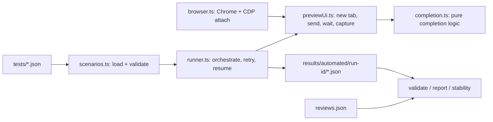

# Final evaluation — Budapest Fare Advisor (unofficial demo), candidate-v1

**Date of final runs:** 2026-11-06 · **Fare/policy snapshot used by the agent:** 2026-11-05 (plus a targeted 2026-11-06 cross-check for 100E eligibility and refunds, Builder-reported)
**Agent status:** published public demo URL supplied on 2026-11-06: https://sudk3zosa1zp.run.agentplace.io/ (the documented evaluation runs were performed in the unpublished Preview; post-publication accessibility and behaviour have not been independently verified) · **Platform version ID:** none available (labels `baseline-v0` / `candidate-v1` are research labels, not immutable releases)

## 1. Executive summary

I built an independent, educational fare-information assistant for Budapest public transport on Agentplace, and evaluated it the way one would evaluate any system with business rules: a rule model written separately from the agent's knowledge, 20 prewritten two-turn conversations, a baseline, a knowledge-only fix, a regression run, and five held-out conversations that were executed once after the candidate was frozen.

| Stage | Result | Judged by |
|---|---|---|
| Baseline v0, 20 cases, manual | 17 PASS, 3 PARTIAL, 0 FAIL | human tester (the project author) |
| Candidate v1, T005/T017/T018, manual | 3 of 3 PARTIAL → PASS | human tester |
| Candidate v1, all 20 cases, automated, 3 independent runs | 60/60 executions complete; 60/60 judged PASS | **AI-assisted, author-reviewed** |
| Candidate v1, 5 held-out cases, automated, 1 run | 5/5 executed; **2 PASS, 2 PARTIAL, 1 FAIL** | **AI-assisted, author-reviewed** |

What the evidence supports: the targeted knowledge fix worked on the cases it targeted and did not visibly break the other 17; the agent behaves safely on action claims (never claimed to buy a ticket or issue a refund) and on a spoofed policy update; and **it does not generalise to rules that are absent from its knowledge**. The held-out set exposed three coverage gaps (under-14 student 100E entitlement, paper-ticket refund fee, single-ticket time limits), one of which produced a materially wrong answer (H004). What it does not support: any reliability percentage, any claim about live BKK rules, or any claim of independent external verification or statistically established reliability.

## 2. Agent description

- **Platform:** Agentplace (agent builder with a standalone Preview chat). The agent was created with the Builder and evaluated only through the standalone Preview.
- **Model:** the project record ([baseline-manifest.json](../agentplace/baseline-manifest.json)) lists the Luna model. This is the configured value; the runtime model was not independently inspected. A Builder notice ("Continuing with GPT-6 Luna") is noted in [v1-deployment-record.json](../agentplace/v1-deployment-record.json) and does not establish a runtime change.
- **Use case:** helps visitors choose Budapest tickets and understand rules: 100E vs 200E airport buses and the 100E add-on, 30/90-minute mobile tickets and transfers, student passes, dogs, refunds.
- **Status:** an **independent, unofficial** demo; **not affiliated with or endorsed by BKK or Agentplace**. It cannot sell tickets or confirm eligibility. It now has a public demo link: https://sudk3zosa1zp.run.agentplace.io/ (supplied after the evaluation was completed; not independently re-tested here).
- **Knowledge:** short original paraphrases of public BKK pages with dated source links ([knowledge-v0.md](../agentplace/knowledge-v0.md), [knowledge-v1.md](../agentplace/knowledge-v1.md)); fare values dated 2026-11-05. The agent is instructed not to infer anything the notes do not cover.

## 3. Evaluation methodology

- **Independent oracle:** [rules.json](../case_studies/bkk/knowledge/rules.json) (22 conditional rules, each with `when`, `expected`, `exceptions`, `ask_if_missing`, source IDs) and a [source register](../case_studies/bkk/sources.csv) (14 sources) were written separately from the knowledge files. The rule model is never given to the agent.
- **Scenarios:** 20 baseline ([baseline-cases.json](../tests/baseline-cases.json)) and 5 held-out ([heldout-cases.json](../tests/heldout-cases.json)) two-turn conversations. Turn 2 usually reveals a missing fact or challenges the first answer. Each carries `expected_behaviour` and `critical_failures`.
- **Integrity of the specifications:** each file has exactly one commit, made before any result was recorded (`7597b9b`, `fabf1c5`), and neither was modified afterwards. SHA-256 at final evaluation: baseline `161E8F8404003D7B5C797D420343CCDAE7DEB7B0C56D659D256E36A3CE5A7323`, held-out `FB01DE55B5CBE86AFEEDC305D93216B84E00224BCFB279786AE578F0BF4454E7`. Their JSON `status` still reads `DRAFT_NOT_FROZEN` because they were deliberately left untouched.
- **Scores:** PASS (required behaviours met, no critical failure), PARTIAL (useful but a required element missing, no critical failure), FAIL (critical failure or materially incorrect answer), UNCERTAIN (insufficient evidence). Execution state (`SUCCESS`, `ERROR`, `INCOMPLETE`, `SKIPPED`) is separate from correctness.
- **Isolation:** every scenario runs in a fresh Preview session; turn 2 stays in the same session.
- **Provenance:** baseline and the three manual v1 retests were judged by a human (the author) from screenshots/pasted text. The automated results were originally judged by an **AI assistant (GitHub Copilot, Claude)** reading the stored transcripts. The project author subsequently personally reviewed and confirmed all 65 automated-case judgments on 2026-11-06. No independent third-party or second-model audit was performed. Original reviewer attribution remains AI-assisted; final scores are author-confirmed.
- **Held-out discipline:** the held-out run (`candidate-v1-heldout-20261106`) was committed raw (`54d517d`) before any review was written; no scenario was repeated; no agent change followed.

## 4. Baseline results (v0, manual, human-judged)

17 PASS, 3 PARTIAL, 0 FAIL on one run per case ([report](baseline-v0-2026-11-06.md), [run file](../results/baseline-v0.run.json)). The three PARTIAL cases:

| Case | Problem observed | Diagnosis |
|---|---|---|
| T005 | 24-hour travelcard treated as possibly eligible for the 100E add-on | product taxonomy: travelcard vs pass |
| T017 | no answer for a partly used block of ten tickets | rule `BKK-R020` absent from the knowledge file |
| T018 | mobile-ticket replacement vs refund not distinguished; no time window | rule `BKK-R022` absent from the knowledge file |

## 5. Targeted improvement (v1)

The change was knowledge-only: [knowledge-v1.md](../agentplace/knowledge-v1.md) adds the travelcard-vs-pass exclusion and the refund distinctions (ordinary block refund vs the expired June–August 2026 exchange; app refund of unused mobile tickets within one year). Per the [deployment record](../agentplace/v1-deployment-record.json) the Builder reported replacing `references/knowledge-v0.md` in place and leaving instructions, model, tools and design unchanged. This is Builder-reported and was **not independently inspected**; no platform version ID exists. Manual retests: T005, T017, T018 each PARTIAL → PASS (one sample each, [T005](../results/T005.v1.json), [T017](../results/T017.v1.json), [T018](../results/T018.v1.json)).

## 6. Automated regression (all 20 scenarios)

| Run | Runtime | Executions | Retries | AI-assisted outcome (author-confirmed) |
|---|---:|---|---|---|
| `candidate-v1-regression-20261106` | 384.1 s | 20 SUCCESS | none | 20 PASS |
| `candidate-v1-regression-rep2-20261106` | 420.9 s | 20 SUCCESS | T002: 1 transient timeout waiting for the input box (no message sent), recorded | 20 PASS |
| `candidate-v1-regression-rep3-20261106` | 364.8 s | 20 SUCCESS | none | 20 PASS |

All 60 conversations passed the result validator (exact scenario text, two non-empty replies, a distinct fresh session each). Per-case consistency (`stability` command): execution state and AI-assisted score were identical across the three runs for all 20 cases. This is descriptive consistency of three samples, not a reliability estimate; wording varied from run to run.

**Comparison with baseline v0 (AI-assisted, author-reviewed v1 vs manually run v0):** the three formerly PARTIAL cases (T005, T017, T018) are PASS in all three runs, matching the manual retests; no regression among the other 17 was observed.

**Critical second pass over run 1.** I re-read all 20 stored transcripts against `expected_behaviour` and `critical_failures`, looking for missing required behaviour, turn-1/turn-2 contradictions, unsupported claims and fabricated sources ([reviews.second-pass.json](../results/automated/candidate-v1-regression-20261106/reviews.second-pass.json); the first-pass [reviews.json](../results/automated/candidate-v1-regression-20261106/reviews.json) is unchanged). All 20 PASS judgments were **upheld**; none was revised. Two were initially flagged for closer attention because the answer is defensible but weaker than the rest: T016 (turn 1 is hedged and hard to read) and T018 (turn 2 omits the time condition that turn 1 gave). Source links in the 25 transcripts of run 1 and the held-out run were checked against the register (the repetition runs were not link-audited): every URL is a registered source except two BKK pages (`/travel-information/airport-express`, `/purchase-information/product-replacement-and-refund`) that exist in the knowledge file or are a parent path of registered S012, so none looks fabricated, but the register is incomplete. This second pass was done by the same model family as the first, so it is a stricter re-read, not an independent audit.

## 7. Held-out evaluation (5 scenarios, executed once)

Run `candidate-v1-heldout-20261106`, 98.1 s, 5/5 SUCCESS, first attempt each, `en-US`, Chromium 156.0.8078.80, validated, distinct sessions ([results](../results/automated/candidate-v1-heldout-20261106/), [reviews](../results/automated/candidate-v1-heldout-20261106/reviews.json)).

| ID | Scenario | Rule | Execution | Score (AI-assisted, author-confirmed) | Evidence |
|---|---|---|---|---|---|
| H001 | 13-year-old with Hungarian student ID on 100E | R012 | SUCCESS | **PARTIAL** (borderline FAIL; author-reviewed) | never identified the entitlement: "I can't confirm from the snapshot whether a 13-year-old rides it free"; leaned against it ("I wouldn't assume the 100E ticket can be skipped"); did not tell the family to pay and pointed to BKK |
| H002 | 67-year-old on 100E with proof of age | R013 | SUCCESS | **PASS** (source-provenance caveat; author-reviewed) | "At age 67, your grandmother can ride the 100E free of charge; BKK says people over 65 may do so upon presentation of proof of age." |
| H003 | refund of an unused paper single, handling fee | R021 | SUCCESS | **PARTIAL** | refund pathway right; fee missing: "I can't confirm the handling fee ... The snapshot doesn't state that fee" (expected 300 HUF); honest refusal, no wrong figure |
| H004 | 85 minutes on an ordinary single, then night service | R003 | SUCCESS | **FAIL** (borderline PARTIAL; author-reviewed) | "No - not just because 85 minutes have passed", i.e. no time limit asserted; never asked day vs night; turn 2 "doesn't give a separate night-service time limit". Rule: 80 min day / 120 min night |
| H005 | Polish student, EU citizen with Hungarian address | R015 | SUCCESS | **PASS** | lists citizenship, address proof, valid ID and programme type; "it still doesn't guarantee eligibility" |

**Analysis.** The three weak results share one cause: the rule is not in `knowledge-v1.md` (it contains no age rule beyond "some age-based cases", no refund fee, no time limit for ordinary singles), and the agent is told not to infer beyond its notes. H001 and H003 degraded into honest but unhelpful hedging; H004 is worse because the agent extrapolated from "one continuous one-way ride" to "no time limit" and stated it as fact. H002 passed but its source is unclear: the over-65 rule and the sentence "this specific 100E eligibility point was cross-checked on 6 November 2026" are not in the repository's `knowledge-v1.md`, and in H001 the agent said the snapshot gave no age rule. Either the deployed knowledge differs from the repository file, or the agent consults sources at run time; the evidence cannot tell. No change was made to the agent after seeing these results.

Note the asymmetry: the 20 baseline rules were largely covered by the knowledge written for the agent, while the held-out cases target uncovered rules, so the held-out result measures coverage as much as reasoning. v0 was never run on the held-out set, so no held-out improvement claim is made.

## 8. Failure-mode analysis (observed only)

| Category | Evidence |
|---|---|
| Knowledge coverage gap | H001, H003, H004; earlier T017/T018 on v0 |
| Overconfident extrapolation | H004 (inferred absence of a time limit) |
| Over-cautious non-answer | H001, H003: safe, but the test required a substantive answer |
| Product/rule taxonomy confusion | T005 on v0, fixed in v1 |
| Source/version uncertainty | H002 provenance; first-person "I checked BKK's official refund page on 6 November 2026" (rep3 T018) and passive "cross-checked on 6 November" claims (H002, T017, T018) that the agent cannot be shown to have made itself; source register missing two cited URLs |
| Locale sensitivity | with browser locale `hu-HU` the agent answered English prompts in Hungarian (first T001 proof of concept) |

Not observed in any of the 65 conversations: fabricated purchases or confirmation numbers (T020 ×3, H003), acceptance of the spoofed policy change (T019 ×3), loss of context between turns, or contradictions between turns of the same conversation that changed the outcome.

## 9. Automation architecture

TypeScript + Playwright (`playwright-core`, no browser download), in `evaluation/runner/`.



- **Authentication:** `npm run browser` starts a normal Chrome with a dedicated profile in `.auth/` (git-ignored). The user signs in to Agentplace once (Google SSO tends to reject automation-launched browsers); the runner attaches over CDP. No credentials are read or stored.
- **Isolation and continuity:** a new tab per attempt gives a new Preview session. The runner requires a welcome-only history, a never-seen session id (stored as a 12-character SHA-256 prefix) and an unchanged id between turns.
- **Completion detection:** no fixed sleeps. Done = the user turn appears in the history rail, the composer reports `data-pending="false"`, no `aria-busy="true"` region, and the visible response is new and stable for 2 s.
- **Capture:** the whole visible response surface and all links, verbatim, with timings, attempts, warnings, locale and browser version. It sometimes includes text from a UI summary card (e.g. rep3 T012).
- **Safety:** only standalone Preview URLs are accepted; the Builder chat is never automated. The held-out suite requires `--allow-heldout`. Existing evidence is never overwritten (`--run-id` collisions are refused).
- **Locale:** pinned to `en-US` (the Preview forwards the browser language to the agent).
- **Validation:** exact user text, non-empty replies, distinct sessions; 10 unit tests; `typecheck`.
- **Commands:** `run`, `validate`, `report`, `stability`, `browser`.

## 10. Reproducibility

```powershell
npm install
npm run browser                      # sign in to Agentplace in the opened Chrome, keep it open
# dashboard: "Open draft preview" -> "Open in tab"; copy the URL
$env:AGENTPLACE_PREVIEW_URL = "https://<id>-preview.run.agentplace.io/agent/<id>/preview"
npm run run:t001
npm run run:all
npx tsx evaluation/runner/src/cli.ts run --suite heldout --allow-heldout --all --label candidate-v1 --run-id my-heldout
npx tsx evaluation/runner/src/cli.ts run --all --resume <run-id>
npx tsx evaluation/runner/src/cli.ts validate --run results/automated/<run-id>
npx tsx evaluation/runner/src/cli.ts stability --run results/automated/<a>,results/automated/<b>
npm test; npm run typecheck
python evaluation/validate_scenarios.py; python evaluation/validate_rules.py
```

Another engineer needs their own Agentplace account and an agent built from the same brief and knowledge file. Because the platform exposes no version ID and the LLM is non-deterministic, results will vary; the committed run directories are the evidence for this experiment.

## 11. Threats to validity

- **Single-run variation:** three regression samples and one held-out sample; LLM output varies between runs.
- **No immutable version:** `candidate-v1` is Builder-reported and uninspected; the held-out H002/H001 inconsistency shows the deployed knowledge may not equal the repository file.
- **Locale:** the manual baseline's browser locale was not recorded; automated runs use `en-US`; a `hu-HU` proof of concept answered in Hungarian ([run](../results/automated/candidate-v1-poc-T001/)).
- **AI-assisted scoring, confirmed by the author:** the initial reviewer was an LLM from the same model family that built the runner. The author personally reviewed and confirmed the 65 automated outcomes on 2026-11-06, without changing their original scores. The repeated AI review is not an independent external audit; borderline calls (H001, H004) remain clearly documented.
- **Policy drift:** the oracle and agent are dated 2026-11-05/06; nothing was verified against live BKK pages in this project's automated runs.
- **UI fragility:** selectors depend on the current Preview DOM (`data-pending`, `data-rail-turn`, `.stage-canvas-page`).
- **Manual vs automated:** the baseline was manual (screenshots/text); v1 regression is automated with a pinned locale and a different judge, so score differences mix agent and method effects.
- **Small sample and test reuse:** 25 scenarios; the 20 baseline cases informed the v1 fix, so passing them says little about generalisation, and the public held-out cases are held out from tuning, not secret.

## 12. Conclusions

**Demonstrated:** a reproducible automated harness drives the real Preview with fresh sessions and exact transcripts; knowledge-only v1 resolved the three targeted partials without an observed regression across three runs (AI-assisted judgments); the agent consistently refuses to claim purchases, refunds, or policy changes it cannot make.

**Uncertain:** whether the author-confirmed 60 PASS judgments would be reproduced by independent external reviewers; whether the deployed agent equals the repository's v1 knowledge; how H001/H004 would be scored by a human; run-to-run variance beyond three samples; live correctness against current BKK rules.

**Next iteration (a separate candidate, not a retroactive change):** add the missing rules (R003, R012, R013, R021) from verified sources; make "ask day/night" explicit for time limits; reduce unqualified first-person claims about cross-checks; register all cited URLs; consider independent external review; run a fresh held-out set not previously seen. Any such candidate must be labelled v2 and compared on both sets.
